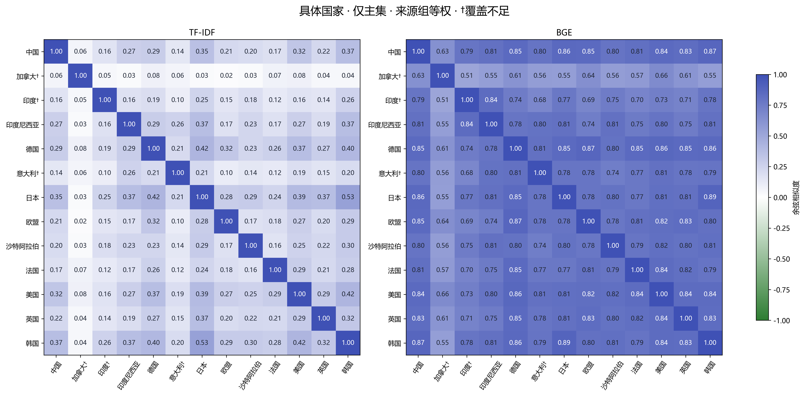
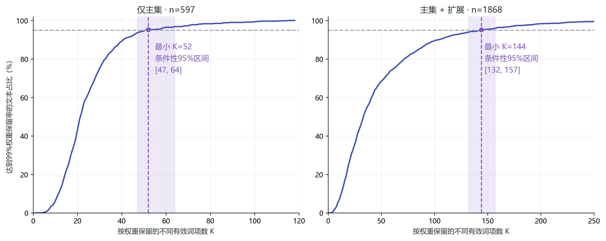

# G20国家双碳政策文本相似性分析

**自然语言处理课程期中项目 · 第一组**

本项目对教师提供的历史双碳文档进行清洗、政策内容抽取、统一分词、文本表征和国家聚合，比较各国政策文本在**主题和措施表述**上的接近程度，并检查结果对数据范围、表征方法及保留词数的敏感性。

仓库名称沿用 `Analysis-of-Policy-Similarities-for-C20-Countries`；课程研究对象为 **G20**。仓库保存最终提交版代码、输入、运行资源、结果、图表、PPT和报告。旧版本、制作缓存及本地虚拟环境不纳入。

## 快速导航

- [分析报告](分析报告%20第一组.docx)
- [课堂展示PPT](G20双碳政策相似性分析%20第一组.pptx)
- [代码与配套材料](代码与配套材料/)
- [相似度、近邻及覆盖结果](代码与配套材料/结果/04_国家关系/)
- [方法评价与词数实验](代码与配套材料/结果/05_评价/)
- [展示图表](代码与配套材料/图/)
- [离线结果展示网页](代码与配套材料/结果展示网页/)
- [资源来源与许可](代码与配套材料/说明/资源来源与许可.md)

## 1. 任务与数据

研究问题：在这批历史双碳政策文本中，各国的主题与措施表述有哪些相近之处？每篇文本需要保留多少个有效词项？词向量能否缓解词汇稀疏性？

| 统计单位 | 最终提交版本数量 |
|---|---:|
| 原始TXT文档 | 2,989篇 |
| 去重事件记录 | 5,965条 |
| 主分析候选事件 | 782条 |
| 扩展候选事件 | 5,183条 |
| 主集有效文章政策文本 | 597条 |
| 主集加入扩展后的有效文章政策文本 | 1,868条 |
| 有有效材料的国家/地区 | 主集13个；加入扩展后18个 |

事件记录、文章政策文本、来源关联组的单位不同；上述事件记录尚不能统称为独立政策。完整国家范围保留于配置与覆盖表中，无材料的国家不以零相似度填补。

同时输出两套聚合：具体国家/地区，以及课程指定六组——**德意、法国、美国、日韩沙特印尼、英国、中国汇总**。六组按清洗后的施策国家映射，而非按原文件夹直接归属。

## 2. 完整方法


### 数据清洗与CM-PACE

**CM-PACE — Policy Attribution, Cleaning and Extraction（政策归属、清洗与抽取方法）**，是本项目自行组织的规则、证据评分与处理流程；CM为指定前缀。

- 规范化繁简表达、清理网页模板，保留可追溯的原文及位置。
- 区分国家目标、公共措施及执行条件，与评论、背景、企业自主安排、地方自主政策。
- 区分施策主体、针对对象、合作方及资金提供方，利用机构映射、政策指代和上下文补充归属证据。
- 明确角色证据优先；国家主体评分S(c)辅助处理竞争候选，来源推定单独记录。
- 状态绑定到具体政策动作，保留草案、宣布、实施、暂停、取消及条件、否定、金额和时间。
- 关联重复报道与版本；未充分确认政策身份的记录保持事件记录口径。

S评分用于**归属判断**，不是经过校准的正确概率，也不能解决全部内容筛选、方向与状态辨识问题。实现和函数索引见[清洗代码](代码与配套材料/src/data_cleaning.py)、[规则目录](代码与配套材料/src/cleaning_rules/)及[说明](代码与配套材料/说明/)。

### 三种文本表征

| 方法 | 实际实现 | 用途与限制 |
|---|---|---|
| TF-IDF | jieba及领域词表分词、停用词过滤；对数TF、平滑IDF、L2归一化 | 可解释共同词项；对近义表达与低词项重叠较敏感 |
| 加权fastText | 复用TF-IDF词元及权重，对300维预训练词向量加权平均 | 缓解近义词与词汇稀疏问题；平均向量可能弱化方向及状态差异 |
| BGE | `BAAI/bge-small-zh-v1.5`，冻结512维模型；长文本重叠分块及加权聚合 | 探索上下文主题接近；未使用本项目数据微调 |

TF-IDF和fastText按权重选择Top-K个**不同有效词项**；不足K则全部保留。重复出现的有效词用于累计词频，TF采用 `1 + ln(tf)`，不是删除所有重复词。BGE读取完整政策文本，不沿用上述Top-K词项输入。

附带fastText去均值对照，用于检查共同方向的影响；不预设其必然改善语义。不同模型的余弦分布不能直接当作准确率比较。

### 国家聚合与解释

采用来源关联组等权聚合，减轻重复报道数量影响；来源组不等于独立政策。保留主集/加入扩展、文章/事件视图、共享来源及教师组成员国家等权等对照。材料不足国家只作有限案例解释。



## 3. 如何运行

建议 **Windows + Python 3.12**。资源已随仓库提供，首次安装Python依赖需要网络。完整下载约256 MiB，包含本地BGE权重。模型权重通过Git LFS保存，其他代码、冻结资源和结果随普通Git提交保存。请先安装Git LFS；使用网页下载ZIP时需确认LFS权重已包含，或改用下方克隆命令。

```powershell
git lfs install
git clone https://github.com/CenMunn/Analysis-of-Policy-Similarities-for-C20-Countries.git
cd Analysis-of-Policy-Similarities-for-C20-Countries
git lfs pull
cd "代码与配套材料"
py -3.12 -m venv .venv
.\.venv\Scripts\python.exe -m pip install -r requirements.txt
.\.venv\Scripts\python.exe -B 运行实验.py --mode classroom
```

也可双击[一键运行.cmd](代码与配套材料/一键运行.cmd)。运行参数位于[config.json](代码与配套材料/config.json)，依赖版本位于[requirements.txt](代码与配套材料/requirements.txt)。

**课堂模式**重读原始ZIP，复用经校验的识别账本，重新执行末端处置、分词、TF-IDF、加权词向量、聚合、评价和绘图；BGE按文本SHA复用冻结编码。它不是重新执行全部识别与模型推理。

完整规则识别：

```powershell
.\.venv\Scripts\python.exe -B 运行实验.py --mode full --output 完整运行新结果
```

同时重新进行BGE推理：

```powershell
.\.venv\Scripts\python.exe -m pip install -r requirements-bge.txt
.\.venv\Scripts\python.exe -B 运行实验.py --mode full --reencode-bge --output 完整含编码新结果
```

可用CUDA时使用GPU，否则使用CPU。默认每次创建带时间戳的输出目录；显式输出目录必须不存在，以保护历史结果。新增语料需要重新准备编码及处置资源，不能直接套用当前冻结资源。

## 4. 代码与文件结构

```text
.
├── README.md
├── LICENSE
├── 分析报告 第一组.docx
├── G20双碳政策相似性分析 第一组.pptx
└── 代码与配套材料/
    ├── 运行实验.py                  # 统一入口
    ├── 一键运行.cmd
    ├── config.json
    ├── requirements*.txt
    ├── src/
    │   ├── data_cleaning.py         # 数据清洗、政策与国家识别
    │   ├── cleaning_rules/          # 按功能分类的清洗规则
    │   ├── text_features.py         # 分词、TF-IDF、Top-K
    │   ├── word_vectors.py          # 加权fastText、BGE、去均值
    │   ├── country_analysis.py      # 国家与六组聚合、相似度
    │   ├── evaluation.py            # 参考评价与词数实验
    │   ├── figures.py               # 可视化
    │   └── verification.py          # 工程检查与冻结
    ├── 输入/                       # 教师提供的原始数据ZIP
    ├── resources/                  # 词典、模型、冻结向量与处置
    ├── 结果/                       # 最终表格及可追溯证据
    ├── 图/                         # 展示及报告用图
    ├── 结果展示网页/               # 离线可视化
    ├── 说明/                       # 函数、资源、许可与方法说明
    └── 核验/                       # 原提交版运行和校验记录
```

原文追溯从[来源索引](代码与配套材料/结果/01_数据清洗/最终分析输入/追溯/来源索引.csv)及其相对路径读取；嵌套CSV字段使用JSON字符串。历史核验文件保留当时的名称与记录；当前报告文件名以本仓库实际文件为准。

## 5. 词数实验：每篇到底需要多少词？

先比较K=50、100、200、全部，再在整数K范围细化。K表示按TF-IDF权重保留的**不同有效词项数**，既不是原文前K个词，也不是出现次数。

在“至少95%的有效文本保留至少99%的TF-IDF权重”这一预先定义标准下：

| 当前语料范围 | 有效文本数 | 来源关联组 | 最小K | 条件性95%区间 |
|---|---:|---:|---:|---|
| 主集 | 597 | 531 | 52 | 47—64 |
| 主集＋扩展集 | 1,868 | 1,432 | 144 | 132—157 |

区间来自当前来源组结构下的重抽样，条件和分层细节见[词数协议](代码与配套材料/结果/05_评价/词数协议.json)。它反映当前语料和权重保留标准的不确定性，不是语义正确性的区间，也不能推出52或144词对所有文档都最优。



## 6. 评价与使用边界

- **工程核验**：原提交记录包含七阶段课堂运行及87项检查通过；本次发布检查与历史运行记录分别保存，不把文件检查说成重新全量实验。
- **参考语义评价**：在相同有效文本对上分别计算主题、措施Spearman，随机配对和专项难例分开。大模型辅助参考标签及整体确认不是独立真人逐条盲审；unknown保留原因，不默认记零。
- **独立验收**：尚未完成。整批正式准确率P、召回率R、F-评价尚未测定；不使用早期开发高分代替。
- **公平对照**：比较模型时控制输入、国家范围和聚合方式；数据、分析单位、模型及K变化分别解释。

参考评价的完整数值、有效样本量和来源见[方法对照CSV](代码与配套材料/结果/05_评价/方法对照.csv)。小样本上的一点差距不足以宣称某个模型全面最好。


### 同口径参考结果摘要

以下取自方法对照CSV中的“语义标签保持的活跃对”，普通配对有效23对、专项难例有效14对，均为开发参考材料。主题和措施分别计算，两个范围不能合并当作整批成绩。

| 方法 | 普通配对：主题 | 普通配对：措施 | 专项难例：主题 | 专项难例：措施 |
|---|---:|---:|---:|---:|
| TF-IDF | 0.194 | 0.272 | 0.329 | 0.703 |
| 加权fastText | 0.445 | 0.502 | -0.119 | 0.303 |
| BGE完整文本 | 0.481 | 0.531 | 0.452 | 0.676 |
| fastText去均值 | 0.466 | 0.473 | 0.404 | 0.650 |

这些相关系数只说明算法排序与当前参考判断的关系。专项难例中的负相关也保留，不能据此小样本宣布某模型全面最好。

向量缓解了稀疏性，但不保证理解所有否定、政策方向或状态。例如“支持新能源补贴”与“取消新能源补贴”可能主题相近，措施方向却相反。**余弦0.8不表示80%政策一致**，本项目也不能据此推断当前立场或实施效果。跨时期混合、国家覆盖不均及少量上下文依赖仍是解释限制。

## 7. 参考方法、模型与许可

- [jieba](https://github.com/fxsjy/jieba)：中文分词，MIT。
- [OpenCC](https://github.com/BYVoid/OpenCC)：繁简转换，Apache 2.0。
- [fastText预训练中文词向量](https://fasttext.cc/docs/en/crawl-vectors.html)：300维；本仓库保留冻结词项子集，词向量遵循CC BY-SA 3.0。
- Grave E, et al. *Learning Word Vectors for 157 Languages*. LREC 2018. [论文](https://aclanthology.org/L18-1550/)。
- Bojanowski P, et al. *Enriching Word Vectors with Subword Information*. TACL 2017. [论文](https://aclanthology.org/Q17-1010/)。
- [BAAI/bge-small-zh-v1.5](https://huggingface.co/BAAI/bge-small-zh-v1.5)：冻结模型，MIT；本项目未进行领域微调。

本仓库保留现有[MIT许可证](LICENSE)，适用范围以项目原创代码为主；第三方模型、词表和词向量分别遵循原许可。[资源来源与许可](代码与配套材料/说明/资源来源与许可.md)及其附带许可文本为具体依据。

课程原始材料、新闻原文及其衍生文本保留原来源与权利声明，**不因根目录MIT许可证而获得额外授权**。仓库不宣称拥有原新闻版权，也不宣称取得独立公开传播授权；再分发或用于课程以外用途前应核实相应权利。
